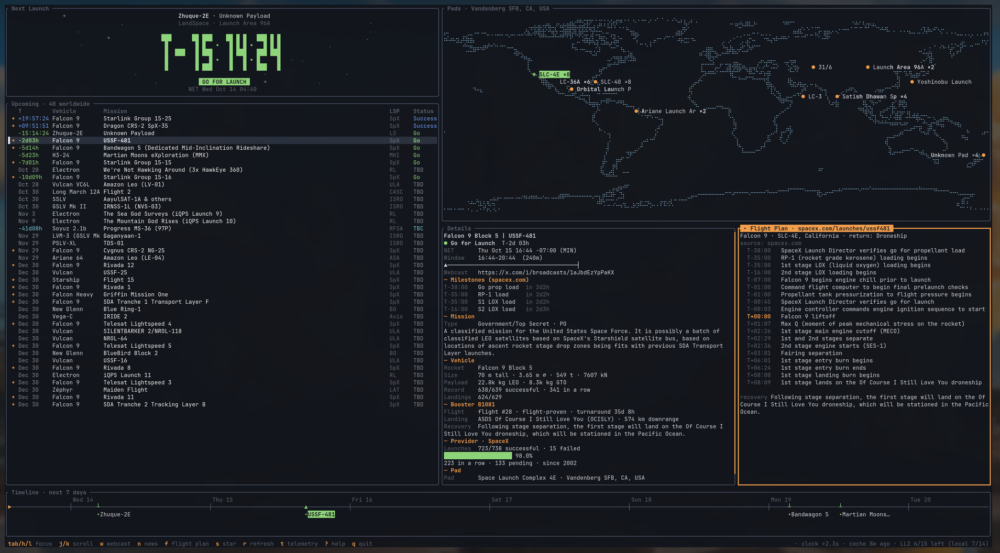
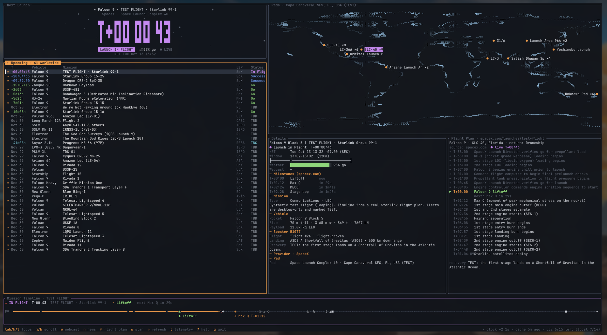
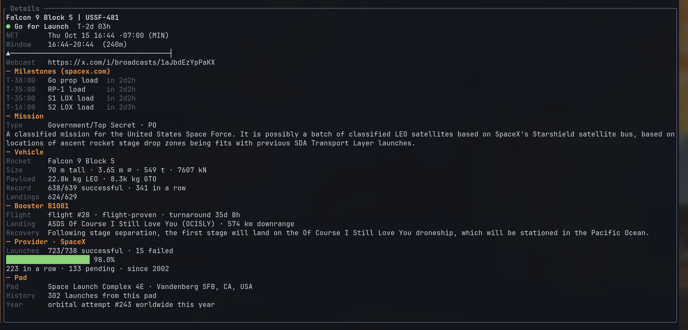
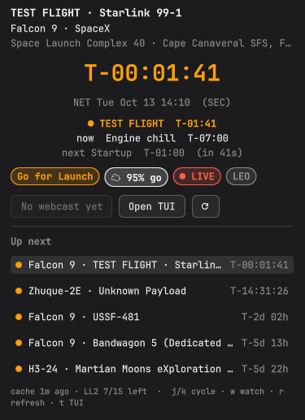

# OmaLiftoff 󱓞

Rocket launch tracker for [Omarchy](https://omarchy.org) (Quattro shell): one Rust binary (daemon + CLI + TUI)
plus a QML bar widget. It tracks **every launch worldwide, from every provider** (SpaceX, Rocket Lab, ULA,
Blue Origin, Arianespace, ISRO, CASC, Roscosmos, ...) via Launch Library 2. Providers that publish more data
about their launches get richer extras: for SpaceX that means spacex.com flight plans and stage-by-stage
milestones in the live mission timeline. Local only, no account, no telemetry.



* **Bar widget** (`liftoff.tracker`): `󱓞 Falcon 9 · T-02:14:07`, current flight event while live, rocket pulses while live / red on hold.
* **TUI**: upcoming launches from all providers, rich details, pads world map, news, live animated mission timeline;
  plus detailed flight plans where the provider publishes them (SpaceX today, LL2 timelines otherwise).
* **Notifications**: desktop (mako) and optional phone push via [ntfy](https://ntfy.sh); new-launch alerts.
* **T-0 sync**: spends LL2's 15 free calls per hour so the last sync lands at T-5 s.

```
liftoff daemon ──► ~/.cache/liftoff/launches.json ◄── Omarchy bar widget (reads the cache only)
      │                         ▲
      ├─► notify-send (mako)    └── liftoff tui
      └─► ntfy (optional)
```

| | |
|---|---|
|  |  |




The popup, captured during the TUI test flight (current + next stage, then the next launches).

## Install

OmaLiftoff has two parts: the **bar widget** (this Omarchy plugin, QML only) and the **companion** (`liftoff`
binary: background daemon, TUI and notifications), which the widget reads from.

### 1. Add the widget

```bash
omarchy plugin add https://github.com/0xRainy/omaliftoff --enable
```

This clones the repo to `~/.config/omarchy/plugins/liftoff.tracker/`. Until the companion is installed the
widget shows **"set up OmaLiftoff"**; clicking it runs step 2 in a terminal.

### 2. Install the companion

```bash
bash ~/.config/omarchy/plugins/liftoff.tracker/install.sh
```

The installer runs from that checkout (nothing is downloaded and executed) and uses `gum` when present:

1. checks for the Omarchy shell, `notify-send`/mako, `curl` and systemd;
2. installs `liftoff` into `~/.local/bin`: either the prebuilt binary for this exact version from GitHub
   Releases (x86_64/aarch64, SHA-256 verified) or a build of this checkout with `cargo build --release --locked`;
3. writes `~/.config/systemd/user/liftoff.service`, does a first fetch and starts it;
4. asks which bar section to use (`omarchy bar move liftoff.tracker --section left|center|right`);
5. runs the notification wizard (desktop alerts, new-launch alerts, optional ntfy with a generated private
   topic or your own server/topic/token, QR code, test push) and asks for starred providers.

It runs entirely as your user (no root) and only writes to `~/.local/bin`, `~/.local/share/liftoff`,
`~/.config/liftoff`, `~/.config/systemd/user/liftoff.service` and the plugin folder (the daemon keeps its
data in `~/.cache/liftoff` and `~/.local/state/liftoff`). An existing
`config.toml` is kept; the wizard only changes the keys you answer. Re-run it to repair or reconfigure;
`liftoff setup` re-runs only the wizard. Flags: `--yes` (defaults, no prompts), `--from-source`.

### Update

```bash
omarchy plugin update liftoff.tracker                      # widget (shows the diff first)
bash ~/.config/omarchy/plugins/liftoff.tracker/install.sh  # companion, from the updated checkout
```

### Remove

```bash
bash ~/.config/omarchy/plugins/liftoff.tracker/install.sh --uninstall   # service, binary, widget; asks about config/cache
# or step by step:
systemctl --user disable --now liftoff.service && rm ~/.config/systemd/user/liftoff.service ~/.local/bin/liftoff
omarchy plugin remove liftoff.tracker
rm -rf ~/.config/liftoff ~/.cache/liftoff ~/.local/state/liftoff ~/.local/share/liftoff   # optional: data
```

### Dependencies

| | Needed for | Arch package |
|---|---|---|
| Omarchy Quattro shell | bar widget | (Omarchy) |
| systemd user session | background daemon | (base) |
| `curl` | prebuilt download, ntfy test | `curl` |
| `notify-send` + a notification daemon | desktop alerts | `libnotify`, `mako` (Omarchy default) |
| Rust toolchain | only when building from source | `rust` or rustup |
| Nerd Font | rocket glyph | JetBrainsMono Nerd Font (Omarchy default) |
| `gum`, `qrencode` | optional: nicer prompts, ntfy QR code | `gum`, `qrencode` |
| ntfy app | optional phone push | [Android](https://play.google.com/store/apps/details?id=io.heckel.ntfy) · [F-Droid](https://f-droid.org/en/packages/io.heckel.ntfy/) · [iOS](https://apps.apple.com/us/app/ntfy/id1625396347) |

Network access (by the companion only): Launch Library 2, Spaceflight News API, spacex.com content API, and
your ntfy server if enabled. Plugins run as unsandboxed code in the Omarchy shell; read the QML
(`omarchy-plugin/`) before enabling. The widget reads the local cache and runs `liftoff` / the installer only
when you click.

### From another checkout (development)

In any other checkout of this repository, `./install.sh` builds/installs the companion and copies the widget
into the plugins folder (dev install).

## Commands

| | |
|---|---|
| `liftoff daemon` | fetch loop + notifications (the systemd unit runs this) |
| `liftoff tui` | dashboard |
| `liftoff fetch` | fetch now (budget-aware) |
| `liftoff refresh` | ask the daemon to refresh soon (bar middle-click) |
| `liftoff status [--waybar]` | `󱓞 Falcon 9 · T-02:14:07` (JSON variant works as a Waybar `custom/` module) |
| `liftoff alerts --dry` | show which notifications would fire now |
| `liftoff test-notify [--desktop\|--ntfy]` | send a sample notification |
| `liftoff setup` | re-run the notification / starred-provider wizard |
| `liftoff doctor` | check service, cache age, API budget, plugin, ntfy, clock |
| `liftoff config get\|set <key> [value]` | read/edit `config.toml` with dotted keys (`notify.ntfy_topic`) |
| `LIFTOFF_API=dev liftoff fetch` | use lldev (no rate limit, stale data) |

## Refresh & rate limits
LL2 free tier is 15 requests/hour. OmaLiftoff fetches `launches/upcoming` (40, `mode=detailed`) every 10 min,
8 min inside T-6h, 5 min inside T-1h and 4 min inside T-15m / in flight. A persisted rolling ledger caps
it at `max_calls_per_hour` (14), and the free `/api-throttle/` endpoint is checked before each call.
On errors the last good cache is kept. News is refreshed every 30 min for the next 5 launches.

## Final syncs (accurate T-0)
LL2 allows 15 calls per rolling hour; OmaLiftoff caps itself at `max_calls_per_hour` (14). For every precise-NET
launch in the next ~75 min the daemon **reserves** single-launch syncs (`/launches/<id>/?mode=detailed`):
T-5 min, T-60 s, **T-5 s**, T+90 s (confirms liftoff / actual NET). Starred providers get all four first;
other launches share what's left round-robin (everyone's T-5 s before anyone's T-60 s). Routine refreshes,
`r`, bar middle-click, `liftoff refresh` and the TUI's own fallback fetch run only if every reserved sync
still fits its rolling hour; otherwise they are refused and the cache is shown. The daemon wakes exactly
for each slot (sub-second), and each sync re-anchors the timeline on LL2's NET.

Clock: the daemon measures skew from HTTP `Date` headers (median of 7, applied only if > 1 s since Date has
1 s resolution); keep `systemd-timesyncd` on, since it is much more accurate. Footer shows last/next sync,
reserved count, clock offset and any nudge.

Webcast sync: `<`/`>` shift T-0 by ∓/±1 s, `M` marks liftoff *now*, `=` clears. Applies to the live launch
(else the selection), is saved to `~/.cache/liftoff/nudge.json` (read by the bar too) as an absolute T-0,
and is dropped automatically if LL2's NET later moves > 2 min (hold / new attempt).

## Notifications
* **T-10 min for every launch worldwide**; **T-24 h and T-1 h** additionally for starred providers
  (default `["SpaceX"]`; toggle with `s` in the TUI or edit `starred_providers`).
* Sent with `notify-send -a Liftoff -A watch=Watch` (click *Watch* → webcast) and a replace hint per launch,
  and as an ntfy JSON publish with title, click URL and a *Watch* action.
* Each alert fires once (state in `~/.local/state/liftoff/state.json`). Only the most specific threshold fires
  (starting the daemon at T-30m gives T-1h, not T-24h). Coarse NETs (day/month) never trigger minute alerts.
* NET changes: small slips don't re-alert; if the NET moves more than ¼ of the threshold the alert re-arms.
  If a launch you were alerted about slips >5 min or goes on **hold**, you get one "Delayed"/"Hold" notice.
* **New launch added**: when a fetch brings a launch id OmaLiftoff has never seen (`Falcon 9 · Starlink 15-30 ·
  NET Oct 20 14:02`). The first run only records what's there; more than 3 at once arrive as one summary.
  `notify.new_launch_alerts` (default on), `notify.new_launch_scope = "all" | "starred"`.
* ntfy is **off** until you configure it (`liftoff setup`).

## TUI keys
`Tab`/`Shift-Tab` or `h`/`l` (`H`/`L`, ←/→) move focus between Upcoming, Details, Flight Plan and Pads
(the focused pane gets a thick accent border and a `▸` title). `j/k` `↑/↓` `PgUp/PgDn` `Ctrl-d/u` `g/G` and the
mouse wheel scroll the focused pane (Upcoming and Pads: move the selection; the wheel scrolls the pane under the
pointer); click focuses a pane / selects a row. `[`/`]` (or `J`/`K`) scroll Details from anywhere. Scrollbars
appear when content overflows. `w` webcast · `n` news (j/k, Enter opens) · `s` star provider · `r` refresh ·
`t` telemetry pane · `f` flight plan pane · `p` spacex.com mission page · `?` help · `q` quit.
Respects `NO_COLOR`; `LIFTOFF_REDUCED_MOTION=1` disables the starfield/blinking.
Telemetry is a stub unless `telemetry_url` points at a JSON endpoint returning `{"altitude": km, "velocity": km/h}`.

## Bar widget
`󱓞 Falcon 9 · T-02:14:07` (Nerd Font rocket, U+F14DE) in plain theme foreground. Only the icon is colored:
normal (Go/TBD/TBC/success) = foreground, live (in flight, webcast live, current stage, or past NET and not
finished) = theme accent pulsing ~1 Hz, hold/failure = red and static (live beats hold, failure beats live).
While live, the current event is added (`󱓞 Falcon 9 · MECO · T+00:02:31`) and the popup shows a Live section
(current + next event, countdown).
Setting `textMode` (auto/always/never): auto shows icon + text in the bar's center section and the icon
only in left/right (and on vertical bars); the tooltip always carries the full text and status.
Events come from the cache the daemon writes (`flight_plans[id].events`, else `launches[].milestones`).

During a live launch the TUI's bottom pane becomes an animated Mission Timeline (sqrt-scaled T-/T+ axis,
progress fill, rocket with exhaust flicker while engines burn, event glyphs ▲ liftoff ◈ Max Q ◼ MECO ✂ stage sep
» SES ◇ fairing ■ SECO ↯ entry ⇣ landing burn ⊥ landing ✦ deploy; separate S1 booster lane after staging;
labels only for the current and next event). Left: popup (patch, status, odds, weather, webcast, next 5) ·
right: webcast · middle: refresh · scroll: cycle launches · last hour: breathing "live mode".
Settings (Setup › Plugins): show vehicle, provider filter, starred only, live window, hide beyond N days,
color mode, cache path, binary path, TUI launcher.

## Configuration
`~/.config/liftoff/config.toml` (created on first run, mode 600). Edit it or use `liftoff config set`,
then `systemctl --user restart liftoff`.

| Key | Default | |
|---|---|---|
| `api_base` | `https://ll.thespacedevs.com/2.3.0` | LL2 base URL (`LIFTOFF_API=dev` for lldev) |
| `api_key` | `""` | LL2 key, if you have a paid tier |
| `upcoming_limit` | `40` | launches fetched |
| `max_calls_per_hour` | `14` | rolling cap (free tier is 15) |
| `news_for_next` | `5` | launches that get news |
| `starred_providers` | `["SpaceX"]` | name or abbreviation, case-insensitive |
| `spacex_flight_plans` | `true` | fetch flight plans from spacex.com |
| `telemetry_url` | `""` | optional JSON `{altitude, velocity}` endpoint |
| `notify.enabled` / `notify.desktop` | `true` / `true` | |
| `notify.ntfy` | `false` | phone push |
| `notify.ntfy_server` / `ntfy_topic` / `ntfy_token` | `https://ntfy.sh` / `""` / `""` | token is sent as `Authorization: Bearer` |
| `notify.all_minutes` | `[10]` | lead alerts for every launch |
| `notify.starred_minutes` | `[1440, 60]` | extra lead alerts for starred providers |
| `notify.notify_changes` | `true` | hold / slip notices |
| `notify.new_launch_alerts` / `new_launch_scope` | `true` / `"all"` | `"starred"` to limit |
| `tui.solid_background` / `background` | `true` / `#12151b` | legible over transparent terminals |
| `tui.mission_patch` / `nerd_font` | `true` / `true` | |

## Data sources and attribution
* [Launch Library 2](https://thespacedevs.com/llapi) by The Space Devs: launches, vehicles, pads, status.
  Free tier: **15 requests per hour per IP**; OmaLiftoff's planner stays under that (see below).
* [Spaceflight News API](https://spaceflightnewsapi.net/) by The Space Devs: news per launch.
* SpaceX content API behind spacex.com launch pages (**unofficial**, undocumented, may change or vanish;
  OmaLiftoff falls back to the LL2 timeline).

Not affiliated with The Space Devs, SpaceX or Omarchy.

The project site embeds a one-glyph subset (the rocket, U+F14DE) of **Symbols Nerd Font** from
[Nerd Fonts](https://github.com/ryanoasis/nerd-fonts) (MIT, © Ryan L McIntyre); the glyph itself is from
[Material Design Icons](https://pictogrammers.com/library/mdi/) by Pictogrammers (Apache-2.0).

## Privacy
No telemetry, no accounts. Data lives in `~/.config/liftoff`, `~/.cache/liftoff`, `~/.local/state/liftoff`.
**Public ntfy topics have no password**: anyone who guesses the name can read your pushes (only launch
info, but still). The wizard generates a random 24-hex topic; keep it private, or use your own server with
an access token.

## Development
CI (`.github/workflows/ci.yml`) runs `cargo test`, the node Model tests and shellcheck; pushing a `v*` tag
builds release tarballs for x86_64 and aarch64 Linux. The project site lives in `docs/` (GitHub Pages).

```bash
cargo test                          # countdown / scheduling / dedupe / parsing tests
node omarchy-plugin/tests/model.test.js
LIFTOFF_API=dev cargo run -- tui
```

<details><summary>Dev: hidden test flight</summary>

In the TUI press `Ctrl-x` then `t` `f` (within 3 s) to toggle a looping synthetic Falcon 9 Starlink launch
(real Starlink 10-22 flight plan; T-2:00 → booster landing in real time, coast to deploy at 20×, ~14 min loop).
It drives the hero, list, details, flight plan and mission timeline, and loops until you press the chord
again. Its alerts are desktop-only and titled `TEST`; it never uses ntfy, never writes the cache or alert state,
and is invisible to the daemon and the LL2 budget. While it runs the TUI writes a display-only marker
(`~/.cache/liftoff/testflight.json`, heartbeat every second) so the **bar widget shows it as live**:
`Test Flight · MECO · T+00:02:31` with the pulsing accent rocket, and the popup shows a TEST FLIGHT banner with
the current + next stage. Turning it off writes a stop record, so the bar returns to normal within a second
and any other open TUI stops its test flight too. Quitting the TUI does the same; if the TUI crashes, the widget
ignores the marker after 5 s.
</details>

## License
MIT © OmaLiftoff contributors. Built with Oma, a Grok Bot assistant.
